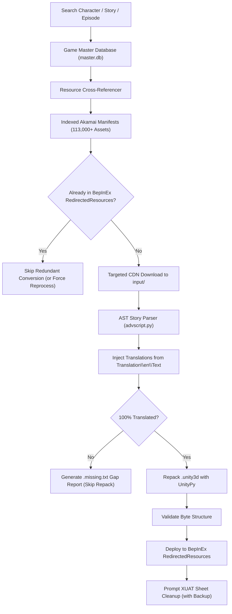

# Princess Connect! Re:Dive Translation & Asset Toolkit (Priconne ADV Tools)

[](https://www.python.org/)
[](https://github.com/K0lb3/UnityPy)
[](LICENSE)
[](tests/)

A universal asset modification, data mining, and translation injection toolchain for **Princess Connect! Re:Dive (プリンセスコネクト！Re:Dive)** Japanese PC/DMM client, integrated with **BepInEx** and **XUnity Auto Translator (XUAT)**.

---

## Highlights & Features

- **Universal Japanese Game Data Miner (`NewDataMiner`)**:
  - Index and search over **113,000+ assets** across 49 official Akamai manifests in milliseconds offline.
  - Download scope preview shows exact file counts and byte sizes (e.g. `1 file(s) (7.2 KB)`) before downloading to prevent blind multi-gigabyte bandwidth consumption.
  - Multi-asset extractor supporting Unity3D `.unity3d`/`.asset` bundles (Text, Textures, Sprites), Criware `.usm` movies to `.mp4`, and `.acb`/`.awb` sound archives to `.wav`.

- **Game Master Database (`master.db`) Integration**:
  - Direct read-only SQLite 3 access across all **998 tables**.
  - Multilingual character search by Unit ID, English name, Japanese name, voice actor (CV), and guild.
  - Story discovery by Episode ID, story group, or Japanese/English chapter title.
  - Skill and dialogue searches for homescreen interactions (`unit_comments`) and guildhouse chirps (`room_unit_comments`).
  - Table exporter to clean standard `.sql` format.

- **Lightweight Database Update Checker**:
  - Performs lightweight HTTP `HEAD` checks against remote deobfuscated database sources (Robo Ninon).
  - Automatically detects new database versions (e.g. `10071600`) from response headers without downloading the 50 MB database.
  - Built-in SQLite integrity check (`quick_check`) and atomic activation with automated `.bak` backups.

- **Intelligent Resource Cross-Referencer**:
  - Automatically maps database entities to CDN manifest bundles with clear status tags:
    - `Confirmed Mapping`: Direct match between database record and manifest bundle (e.g. Story ID `1058001` -> `storydata_1058001.unity3d`).
    - `Possible Mapping`: Heuristic match on unit voice, spine, or icon assets.
    - `Unresolved`: Record exists in database, but corresponding bundle absent from current manifests.
    - `Not Present in Current Database`: Asset exists in manifest, but entity absent from database.

- **Pre-Conversion Duplicate Detection & Strict Boundary Scanning**:
  - Strictly isolates XUAT translation sheet scanning to `Translation\en\Text` and redirected asset scanning to `Translation\en\RedirectedResources`.
  - Indexes existing BepInEx patch bundles (2,400+ files in ~5ms) before conversion.
  - Detects already implemented assets and skips redundant conversions by default.
  - 4 Naming Strategies: `auto_redirect`, `preserve_original`, `match_existing`, and `custom_pattern`.

- **Lossless AST Story Parser & Gated Repacking**:
  - Full round-trip byte-exact serializer (`advscript.py`, `advverify.py`).
  - **Repack Gating**: Only repacks into `.unity3d` if 100% of real dialogue lines are translated.
  - Generates line-by-line `.missing.txt` gap reports for incomplete scripts.
  - Prompts safe cleanup of translated lines from XUAT sheets with automatic backups.

- **Interactive Conflict Manager GUI**:
  - Dedicated GUI (`conflict_manager.py`) to resolve duplicate translation line conflicts across projects.

---

## Architecture & Workflow



---

## System Requirements

- **Operating System**: Windows 10 / 11 (64-bit)
- **Python Version**: **Python 3.11, 3.12, 3.13, or 3.14** (64-bit)
  > [!IMPORTANT]
  > Python 3.15 is currently **not supported** because UnityPy requires precompiled `lz4` binary wheels that are only available for Python 3.11 through 3.14.

---

## Installation & Setup

### 1. Clone the Repository
```bash
git clone https://github.com/your-username/priconne-adv-tools.git
cd priconne-adv-tools
```

### 2. Install Python Dependencies
Using Python 3.12 (or the `py` launcher):
```bash
py -3.12 -m pip install -r requirements.txt
```

### 3. Initialize Game Master Database (`master.db`)
The repository includes a one-click remote database installer that downloads and validates the latest deobfuscated database:
```bash
py -3.12 -m NewDataMiner.cli --update-db
```
*(Or launch `4_dataminer.bat` and select Option 11)*.

---

## Quick Start (Batch Launchers)

For Windows users, double-clickable `.bat` launchers are provided in the root folder:

| Launcher | Purpose |
|---|---|
| **`5_integrated_workflow.bat`** | **Complete Pipeline**: Search character/story $\to$ check RedirectedResources $\to$ download $\to$ translate $\to$ gated repack $\to$ validate. |
| **`4_dataminer.bat`** | **Data Miner & DB Explorer**: Offline manifest search, scope preview, sound/movie extraction, and database browser. |
| **`3_xuat_repack.bat`** | **1-Click XUAT Repack**: Injects XUAT translation sheets into `input/*.unity3d` and writes to `output/`. |
| **`conflict_manager.bat`** | **Conflict Resolver**: Launches GUI to resolve duplicate line translation mismatches. |
| **`priconne_tool.bat`** | **Interactive Story Tool**: Extract, repack, probe, verify, and configure settings. |
| **`1_extract.bat`** | Extracts `input/*.unity3d` into readable script text `text/*.txt`. |
| **`2_repack.bat`** | Repacks edited `text/*.txt` back into `output/*.unity3d`. |

---

## Command Line Interface (CLI)

### 1. Master Database Exploration (P3)
```bash
# Search characters by English or Japanese name, ID, or Voice Actor
py -3.12 -m NewDataMiner.cli --db-unit "Pecorine"
py -3.12 -m NewDataMiner.cli --db-unit "ペコリーヌ"

# Search story episodes by ID or title
py -3.12 -m NewDataMiner.cli --db-story "1058001"

# Cross-reference an entity to asset manifest bundles
py -3.12 -m NewDataMiner.cli --cross-ref "105801"

# List all 998 tables in master.db
py -3.12 -m NewDataMiner.cli --list-tables

# Export a database table to standard SQL
py -3.12 -m NewDataMiner.cli --export-sql "room_unit_comments"
```

### 2. Database Update Checking (P4)
```bash
# Lightweight check (reads remote HTTP headers in milliseconds)
py -3.12 -m NewDataMiner.cli --check-db-update

# Download and install updated database with automatic backup
py -3.12 -m NewDataMiner.cli --update-db
```

### 3. Targeted Asset Mining (P2)
```bash
# Search offline across all 113,000+ manifest entries
py -3.12 -m NewDataMiner.cli -s "bgm_AM01" -c sound

# Targeted download with size preview
py -3.12 -m NewDataMiner.cli -s "9080155" -c story --download --extract
```

### 4. End-to-End Integrated Workflow (P5)
```bash
# Run workflow on a specific story episode (e.g. 1058001)
py -3.12 priconne_tool.py workflow -q "1058001"

# Run full test suite
py -3.12 tests/run_all_tests.py
```

---

## Directory Structure

```text
priconne-adv-tools/
├── NewDataMiner/               # Universal Data Miner & Database Engine
│   ├── __init__.py
│   ├── config.py               # CDN endpoints, pool types, tool paths
│   ├── models.py               # ManifestEntry, DownloadScope, AssetCategory
│   ├── manifest_manager.py     # 49 manifests indexer (sub-second query)
│   ├── downloader.py           # Resumable, concurrent chunked downloader
│   ├── extractor.py            # Unity3D, Criware USM video, ACB/AWB audio
│   ├── database.py             # Direct SQLite reader (998 tables)
│   ├── resource_cross_ref.py   # Database entity <-> Manifest cross-referencer
│   ├── db_updater.py           # Lightweight HEAD update checker & validator
│   ├── dataminer.py            # High-level API facade
│   └── cli.py                  # Interactive CLI & menu
├── manifest/                   # 49 Akamai game asset manifests
├── usmtoolkit/                 # USM movie demuxer & tools
├── tests/                      # Unified Test Suites (100% Pass)
│   ├── test_asset_registry.py
│   ├── test_new_dataminer.py
│   ├── test_database_integration.py
│   ├── test_db_updater.py
│   ├── test_integrated_workflow.py
│   └── run_all_tests.py
├── advscript.py                # ADV story AST parser, serializer & XUAT injector
├── advverify.py                # Byte-exact verification engine
├── asset_registry.py           # BepInEx boundaries, duplicate detection & naming
├── conflict_manager.py         # Duplicate line conflict resolver (GUI)
├── priconne_tool.py            # Main CLI & interactive menu
├── raw2xuat.py                 # Raw text to XUAT sheet converter
├── xuat2raw.py                 # XUAT sheet to raw text converter
├── 1_extract.bat               # Batch launcher: Extract .unity3d -> text/*.txt
├── 2_repack.bat                # Batch launcher: Repack input + text -> output/*.unity3d
├── 3_xuat_repack.bat           # Batch launcher: 1-Click XUAT injection & repack
├── 4_dataminer.bat             # Batch launcher: Universal Data Miner & DB Explorer
├── 5_integrated_workflow.bat   # Batch launcher: Complete End-to-End Workflow
├── conflict_manager.bat        # Batch launcher: Conflict Manager GUI
├── priconne_tool.bat           # Batch launcher: Story Tool menu
├── input/                      # Input Unity3D bundles
├── output/                     # Repacked output Unity3D bundles
├── text/                       # Extracted & translated script texts
├── .gitignore                  # Clean Git ignore rules
├── requirements.txt            # Python dependencies
├── LICENSE                     # MIT License
├── README.md                   # This documentation
├── PROJECT_PLAN.md             # Development architecture & phasing
├── PROGRESS.md                 # Progress logs & test tracking
└── DECISIONS.md                # Technical decisions & standards
```

---

## Community Q&A & Resource Mapping Reference

- **Where are guildhouse interaction / chirping texts stored?**  
  Stored in `master.db` inside the `room_unit_comments` table. Corresponding voice audio files are stored in `soundmanifest` as `v/vo_room_<unit_id>.acb` and `v/vo_room_<unit_id>.awb`.
- **Where are homescreen dialogue lines stored?**  
  Stored in `master.db` inside the `unit_comments` table. Corresponding character voice files are located in `soundmanifest` as `v/vo_cmn_<unit_id>.acb` and `v/vo_cmn_<unit_id>.awb`.
- **Where are character and event stories stored?**  
  Database records in `story_detail` and `story_data` contain episode metadata and titles. The actual story scripts are stored in asset bundles named `a/storydata_<story_id>.unity3d` in `storydata2_assetmanifest`, with voice acting in `soundmanifest` under `v/vo_adv_<story_id>.acb/awb`.
- **Where are skill descriptions stored?**  
  Stored in `master.db` inside `skill_data`. Corresponding icons are located in `icon2_assetmanifest` as `a/icon_skill_<icon_type>.unity3d`.

---

## Testing & Verification

Run the entire test suite with one command:
```bash
py -3.12 tests/run_all_tests.py
```
Expected output:
```text
======================================================================
  PRINCESS CONNECT! RE:DIVE - FULL TEST SUITE VERIFICATION
======================================================================
Ran 25 tests in 3.415s

OK
======================================================================
  ALL TESTS PASSED SUCCESSFULLY! (100% Pass Rate)
======================================================================
```

---

## Contributing & License

Contributions, bug reports, and pull requests are welcome!  
This project is licensed under the [MIT License](LICENSE).
